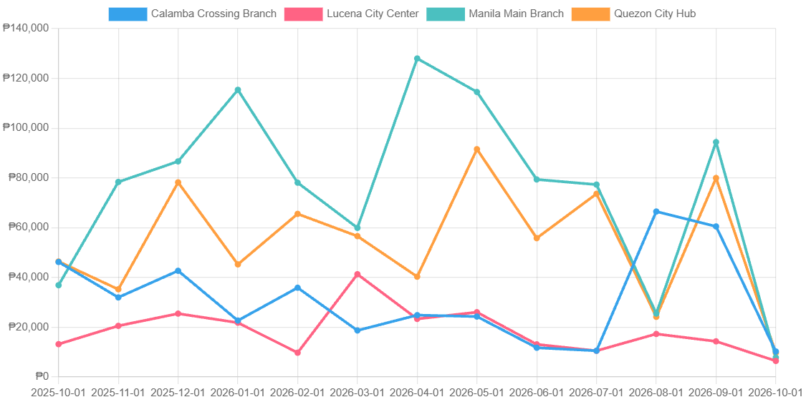
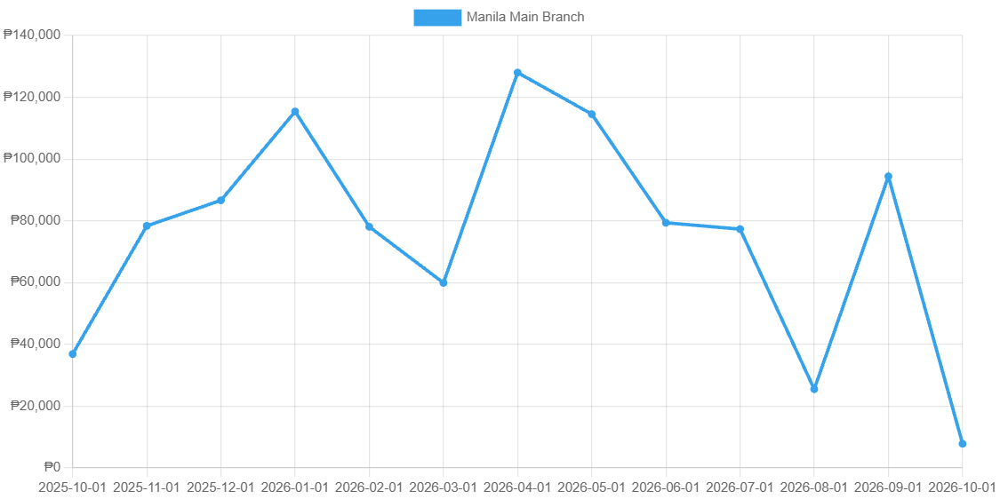
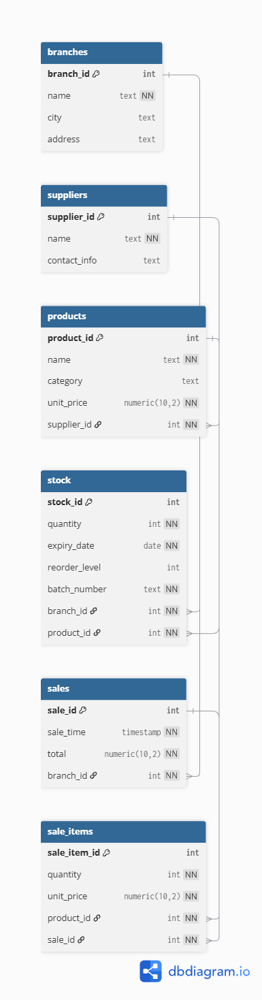

# Pharmacy Inventory Tracker

A production-grade multi-branch pharmacy inventory management system built with PostgreSQL, FastAPI, and an interactive frontend dashboard.

### Core Capabilities Demonstrated
* **Advanced Relational Modeling**: Multi-branch stock tracking, batch-level expirations, and strict check/uniqueness constraints.
* **Complex SQL Analytics**: Analytical queries, aggregation reports, window functions (`ROW_NUMBER`), modular database views, and stored SQL functions.
* **Performance Engineering**: Query plan profiling (`EXPLAIN ANALYZE`), index impact comparisons (Bitmap Index Scan vs. Sequential Scan), and composite index optimizations.
* **Production-Ready REST API**: Parameterized SQL queries using `psycopg` dictionary row factories and clean FastAPI routing.
* **Interactive Frontend**: Native JavaScript dashboard leveraging Chart.js for time-series revenue trends and reactive table filtering.
* **Automated Testing**: Comprehensive API and database integrity test suite using `pytest` and transaction rollback fixtures.

---

## Dashboard Preview





---

## Schema Architecture



Stock is tracked at the **batch level** (one record per branch, product, and batch number), enabling precise expiration tracking and realistic pharmaceutical inventory segregation.

---

## Tech Stack

* **Language**: Python 3.14
* **Database**: PostgreSQL 17
* **Backend**: FastAPI, Uvicorn
* **Database Driver**: Psycopg 3 (with `dict_row`)
* **Visualization & Frontend**: Vanilla HTML5/CSS3, JavaScript, Chart.js
* **Testing**: Pytest, FastAPI TestClient

---

## Setup & Quickstart

Follow these steps from a fresh clone:

1. **Clone the repository and prepare the virtual environment**:
   ```bash
   git clone <repo-url>
   cd pharmacy-inventory-tracker
   python -m venv .venv
   source .venv/bin/activate   # On Windows: .venv\Scripts\activate
   pip install -r requirements.txt
   ```

2. **Create the PostgreSQL database**:
   ```bash
   createdb -U postgres pharmacy
   ```

3. **Set your database credentials**:
   ```bash
   export PGPASSWORD="your_postgres_password"
   # On Windows (cmd): set PGPASSWORD=your_postgres_password
   # On Windows (PowerShell): $env:PGPASSWORD="your_postgres_password"
   ```

4. **Initialize and seed the database in exact sequence**:
   > **Note on Execution Order**: `01_schema.sql` starts with `DROP TABLE ... CASCADE`, which drops existing tables and any dependent views. Always run the seed script, views, and functions following a schema reset.
   ```bash
   psql -U postgres -d pharmacy -f sql/01_schema.sql
   python app/seed.py          # Windows: python app\seed.py
   psql -U postgres -d pharmacy -f sql/03_views.sql
   psql -U postgres -d pharmacy -f sql/04_functions.sql
   ```

5. **Run the application**:
   ```bash
   uvicorn app.main:app --reload
   ```
   Open [http://127.0.0.1:8000/](http://127.0.0.1:8000/) in your browser. API documentation is accessible at [http://127.0.0.1:8000/docs](http://127.0.0.1:8000/docs).

6. **Run the automated test suite**:
   ```bash
   pytest -v
   ```

---

## API Endpoints

| Method | Endpoint | Query Parameters | Description |
| :--- | :--- | :--- | :--- |
| `GET` | `/health` | _None_ | Service health check. |
| `GET` | `/branches` | _None_ | Lists all branch locations with cities and addresses. |
| `GET` | `/reports/low-stock` | `branch_id` (optional) | Returns active batches with quantities at or below reorder levels. |
| `GET` | `/reports/monthly-sales` | `branch_name` (optional) | Summarizes monthly sales volume, revenue, and average transaction size. |
| `GET` | `/reports/expiring` | `branch_id` (required), `days` (optional, default `60`) | Lists active batches expiring within the specified window. |
| `GET` | `/reports/top-sellers` | `branch_name` (optional) | Retrieves top 5 best-selling products per branch ranked by units sold and revenue. |
| `GET` | `/reports/restock` | `branch_id` (required) | Calculates suggested reorder quantities for products below safety levels. |

---

## Known Simplifications

* **Static Sales Seeding**: Simulated sales data is generated independently for analytical reporting and does not decrement the physical batch quantities in `stock`.
* **Chart Edge Months**: Because sales records span a sliding window relative to the execution date, the initial and concluding calendar months may contain partial-month figures.
* **Restock Logic Window**: The `fn_restock_list` function aggregates active, non-expired batches; products with zero existing inventory batches are excluded from the suggested restock output.

---

## Tooling & AI Disclosure

This project was developed with the assistance of AI tools (including LLM-based coding assistants) to aid in data schema design, mock data generation workflows, query optimization, and boilerplate FastAPI endpoint implementation. All generated database structures, queries, and application code have been independently verified, tested, and reviewed for schema accuracy, constraint integrity, and query performance.